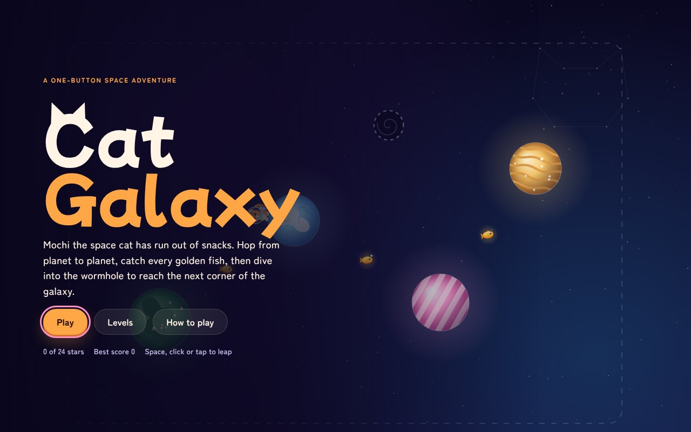
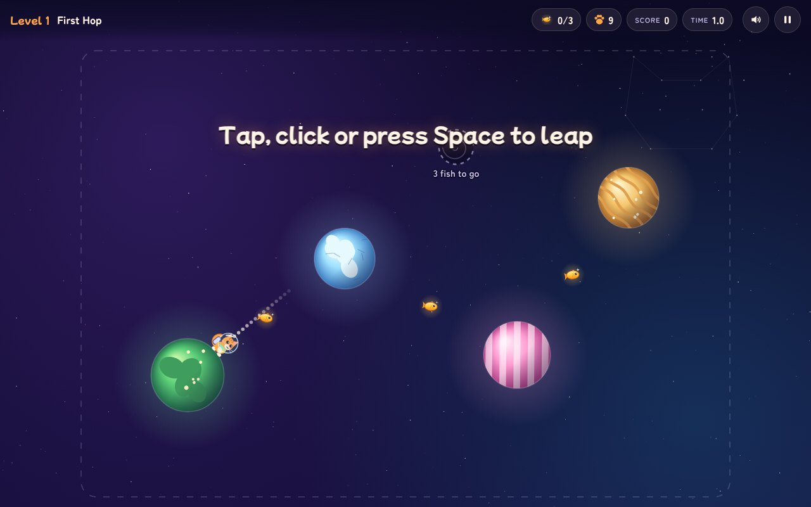
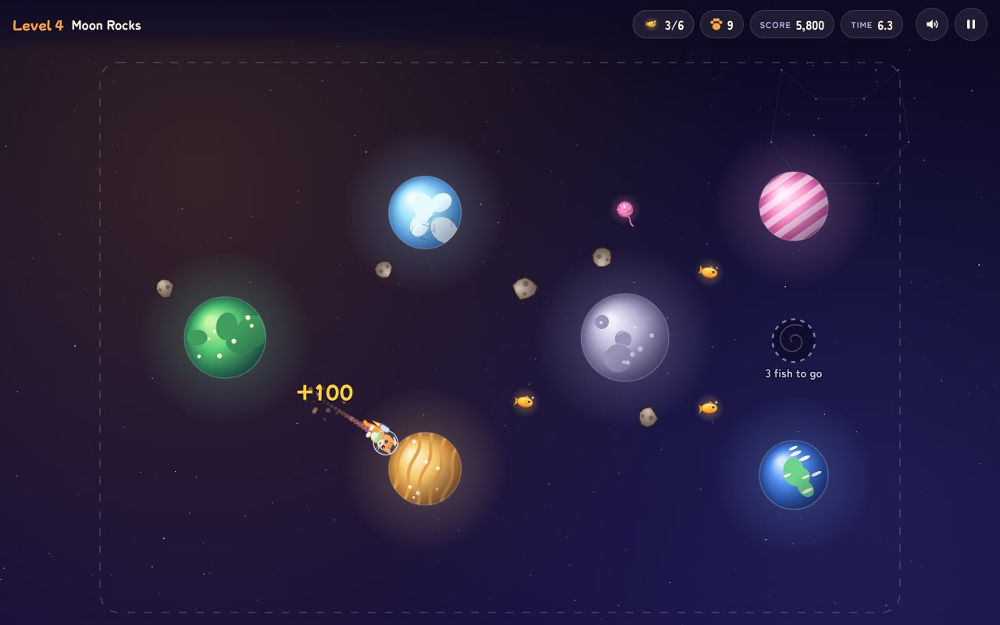
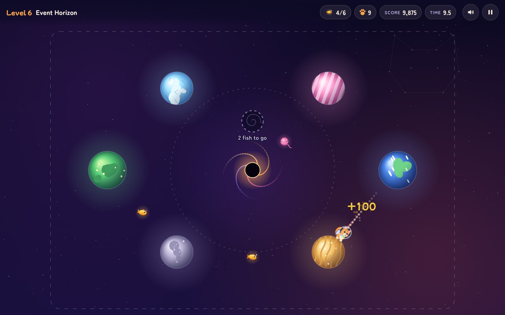
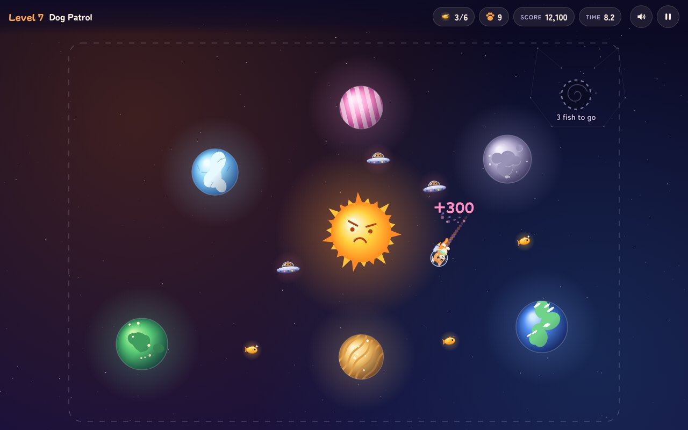
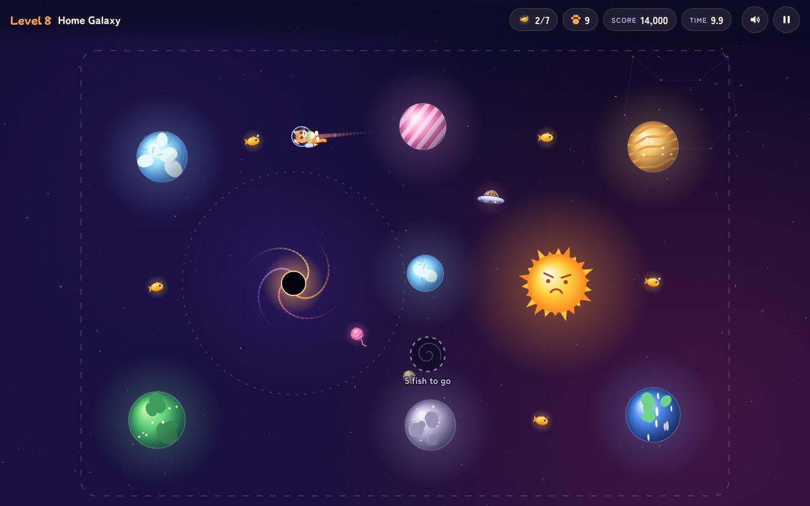
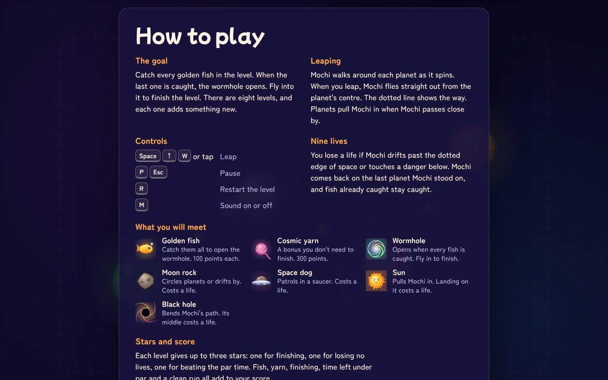
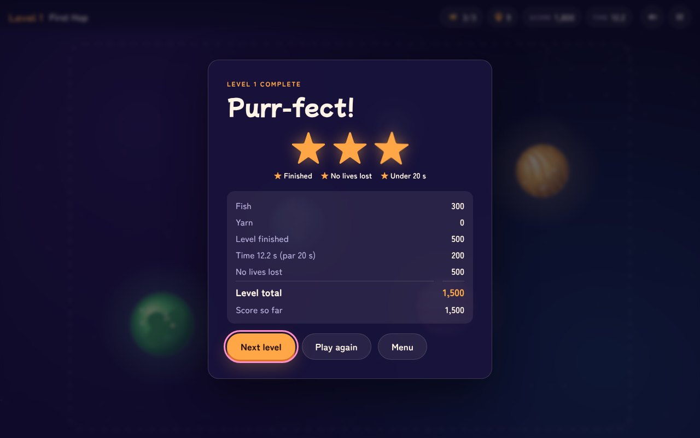
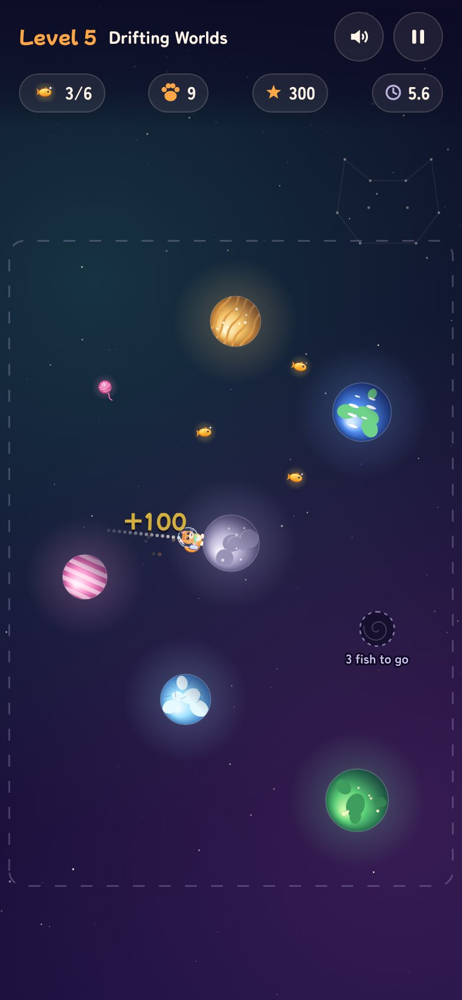

# Cat Galaxy

A one-button space game. Mochi the space cat has run out of snacks. Hop from planet to planet, catch every golden fish, and dive into the wormhole to reach the next corner of the galaxy.



The whole game is one file, [`index.html`](index.html): HTML, CSS and plain JavaScript, with no libraries and no image or sound files. The pictures are drawn by the code and the sound effects are made by the code as you play. Two fonts come from Google Fonts when there is a connection; without one the game uses the computer's own fonts.

## Play

1. Download [`index.html`](index.html) (the **Download raw file** button above the code on GitHub).
2. Open it in a web browser on a computer, tablet or phone.

It works with a keyboard, a mouse or a touch screen, and fits any screen size. On a phone held upright the galaxy turns on its side so it fills the screen.

## How to play

Mochi walks around each planet as it spins. When you leap, Mochi flies straight out from the planet's centre, so wait until Mochi faces where you want to go. A dotted line shows the way. Planets pull Mochi in when Mochi passes close by.

| | Keyboard | Mouse or touch |
|---|---|---|
| Leap | <kbd>Space</kbd>, <kbd>↑</kbd>, <kbd>W</kbd> or <kbd>Enter</kbd> | Click or tap anywhere |
| Pause | <kbd>P</kbd> or <kbd>Esc</kbd> | The pause button |
| Restart the level | <kbd>R</kbd> | Pause, then **Restart level** |
| Sound on or off | <kbd>M</kbd> | The sound button |

### Rules

- **Goal:** catch every golden fish in the level. That opens the wormhole. Fly into it to finish the level.
- **Nine lives** (Mochi is a cat). You lose one if Mochi drifts past the dotted edge of space, touches a moon rock or a space dog, lands on a sun, or falls into the middle of a black hole. Mochi comes back on the last planet Mochi stood on, and fish already caught stay caught. Lives carry over to the next level. Lose all nine and you can try the level again with nine fresh lives.
- **Three stars per level:** one for finishing, one for losing no lives, and one for beating the par time.
- **Score:** 100 points for each fish, 300 for each cosmic yarn ball, 500 for finishing a level, 500 more for losing no lives in it, and 25 points for every second you finish under par.
- Finish a level to open the next one. Your stars, best score and sound setting are saved in your browser.

### The eight levels

Each level adds something new.

| | Level | What is new |
|---|---|---|
| 1 | First Hop | Leaping from planet to planet |
| 2 | Fish Belt | Cosmic yarn, a bonus you don't need to finish |
| 3 | Spin Cycle | Small planets that spin fast |
| 4 | Moon Rocks | Rocks that circle planets or drift across space |
| 5 | Drifting Worlds | Planets that slide back and forth |
| 6 | Event Horizon | A black hole that bends Mochi's path |
| 7 | Dog Patrol | Space dogs in saucers, and a sun too hot to land on |
| 8 | Home Galaxy | All of it at once, around a small, fast planet between a black hole and a sun |

<table>
<tr>
<td width="50%"><br><b>1. First Hop</b></td>
<td width="50%"><br><b>4. Moon Rocks</b></td>
</tr>
<tr>
<td><br><b>6. Event Horizon</b></td>
<td><br><b>7. Dog Patrol</b></td>
</tr>
<tr>
<td><br><b>8. Home Galaxy</b></td>
<td><br><b>How to play, in the game</b></td>
</tr>
<tr>
<td><br><b>Level complete</b></td>
<td><br><b>On a phone held upright</b></td>
</tr>
</table>

## How it is made

`index.html` is laid out in clearly marked, commented parts:

```
<style>               design tokens, layout, HUD, menu screens, buttons, and the
                      rules for small, short and large screens
<main id="stage">     the game area: the <canvas> the galaxy is drawn on, the HUD
                      on top of it, and the menu screens (title, levels, how to play,
                      level card, pause, level complete, out of lives, the ending)
<script id="core">    the rules: tuning numbers (CONFIG), the eight levels (LEVELS),
                      movement, gravity, collisions and scoring. It never touches
                      the page, so the checks in test/ run the very same code in Node.
<script id="app">     everything you see and hear: saving, sound, fitting the galaxy
                      to the screen, drawing, screens, input and the main loop
```

- **The rules** run in fixed steps, 120 a second, however fast the screen refreshes, so the game plays the same on every computer.
- **Gravity:** each planet pulls Mochi in when Mochi flies close, which helps near misses land. Black holes pull from much further away, and the sun pulls harder than a planet.
- **Any screen:** the galaxy is 1200 by 800 units and is scaled to fit below the HUD. When the screen is taller than it is wide, only the drawing turns a quarter turn; the rules don't change.

### Changing it

- `CONFIG` at the top of `<script id="core">` holds the feel of the game: leap speed, gravity, lives, scoring.
- `LEVELS` holds the levels. Each one lists its planets, fish, yarn, rocks, dogs, black holes and the wormhole, with short building blocks such as `planet(x, y, radius, spin, kind)`, `fish(x, y)` and moves such as `glide(...)` and `orbit(...)`. The comment above `LEVELS` explains them all.
- The sprites (Mochi, the fish, the planets and the rest) are drawn with canvas paths in part 6 of `<script id="app">`.

After changing a level, run the checks below to make sure it can still be finished.

### Checks

```
npm test                  # about a minute: every level, with the game's own rules
npm run test:browser      # a few minutes: the game in a real browser
npm run screenshots       # the browser checks, saving the pictures on this page
```

`npm test` needs only [Node.js](https://nodejs.org), version 18 or newer. The browser checks use [Playwright](https://playwright.dev); install it once with `npm install` and `npx playwright install chromium`.

- `test/levels.js` checks each level's layout: everything stays inside the galaxy, nothing sits inside a planet, and no rock or dog can ever hit Mochi standing on a planet. Then a search (`test/solver.js`) proves each level can be finished without losing a life, using only leaps that still work when pressed up to 50 ms early or late. It also checks that the par times are fair and that every yarn ball can be caught on a leap that ends safely.
- `test/browser.js` loads the page at 13 window sizes, from a small phone to a large monitor, and checks that nothing scrolls sideways, the buttons show without scrolling, and the galaxy fits below the HUD. It checks that a key press and a tap both make Mochi leap and that pausing stops the clock. Then it plays all eight levels through the real page, from the title screen to the ending, and expects three stars on every level.
