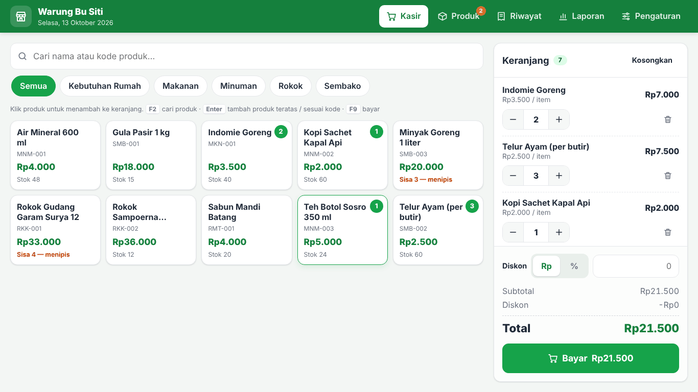
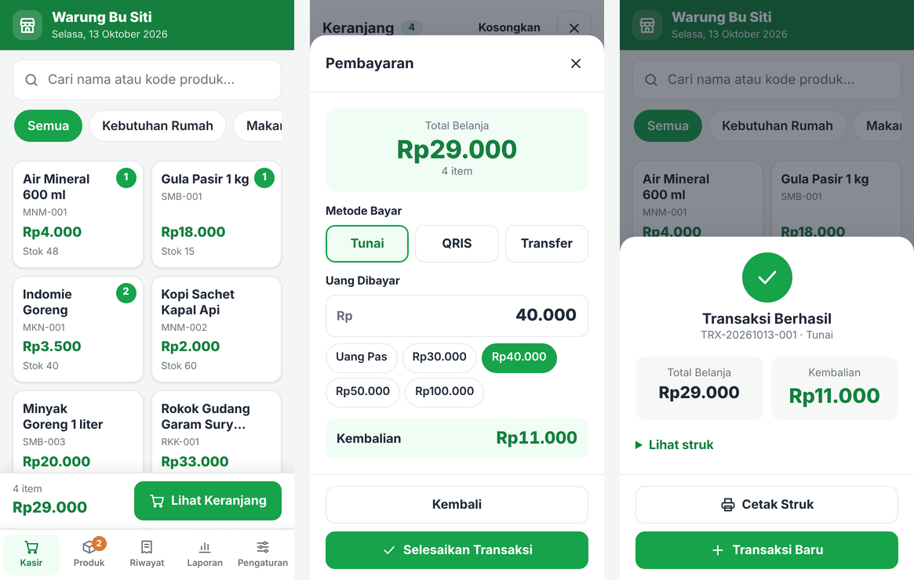
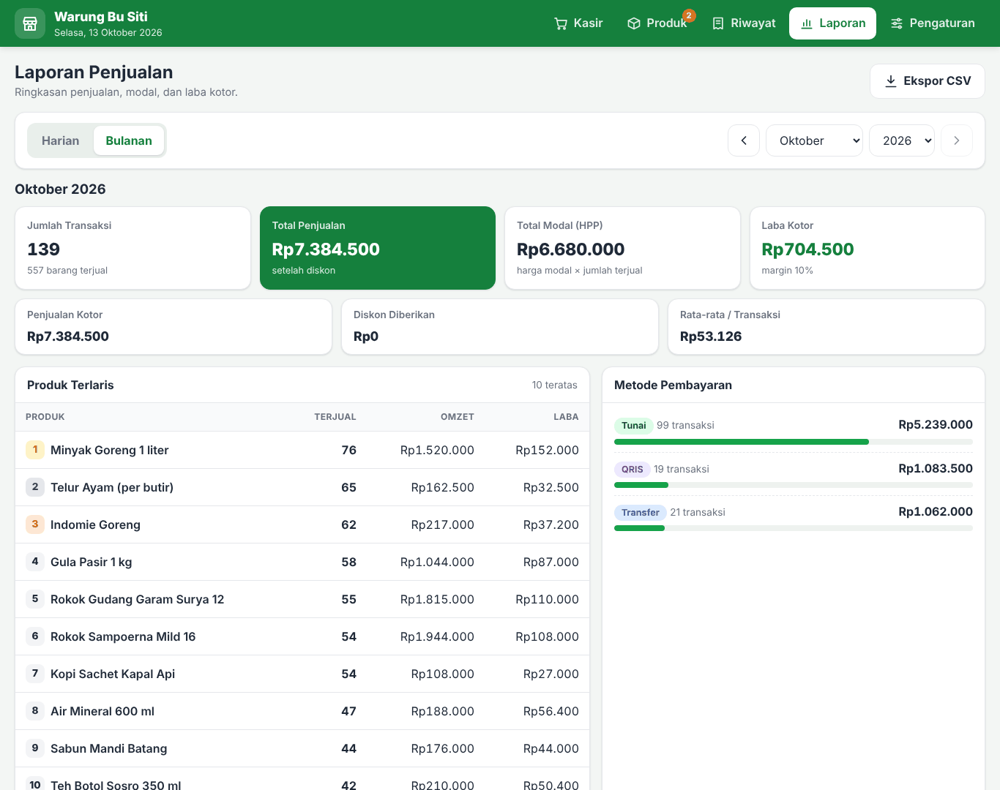

# Kasir Warung

Aplikasi kasir (Point of Sale) sederhana untuk warung kecil. Seluruh aplikasi ada di **satu file**, [`index.html`](index.html). Tidak perlu internet, server, database, atau instalasi apa pun. Cukup buka file-nya di browser (Chrome, Edge, Firefox, atau Safari).





## Fitur

- **Kasir**: pilih barang dengan klik atau ketik nama/kode (bisa memakai alat scan barcode), ubah jumlah, diskon dalam rupiah atau persen, bayar Tunai / QRIS / Transfer, kembalian dihitung otomatis, stok berkurang sendiri, dan cetak struk 58 mm.
- **Produk**: tambah, ubah, dan hapus barang (nama, kategori, harga jual, harga modal, stok, kode). Ada pencarian, filter kategori, tombol tambah stok masuk, dan peringatan stok menipis.
- **Riwayat**: semua transaksi dengan filter tanggal. Struk bisa dicetak ulang dan transaksi yang salah bisa dibatalkan (stok otomatis kembali).
- **Laporan**: ringkasan harian atau bulanan berisi jumlah transaksi, total penjualan, total modal (HPP), laba kotor, produk terlaris, dan penjualan per metode bayar. Bisa diekspor ke file CSV untuk dibuka di Excel.
- **Pengaturan**: nama toko, alamat, dan catatan kaki struk. Ada juga backup dan pulihkan data (file JSON) serta reset semua data.

Saat pertama dibuka, aplikasi sudah berisi 10 contoh produk warung supaya bisa langsung dicoba.



---

## 1. Cara menjalankan di laptop

1. **Unduh file `index.html`.** Buka [`index.html`](index.html) di halaman GitHub ini, lalu klik tombol **Download raw file** (ikon panah ke bawah di kanan atas kotak kode).
2. **Simpan di folder yang tetap**, misalnya `Dokumen\Kasir Warung\index.html`. Jangan pindah-pindah file ini nanti (penjelasannya ada di bagian [Penting tentang data](#4-penting-tentang-data)).
3. **Klik dua kali** file `index.html`. Aplikasi akan terbuka di browser.
   - Kalau yang terbuka bukan browser, klik kanan file → **Open with / Buka dengan** → pilih **Google Chrome** atau **Microsoft Edge**.
4. Supaya mudah dibuka lagi, buat bookmark (tekan `Ctrl + D`) atau seret ikon gembok/alamat di browser ke desktop.

Sudah selesai. Tidak ada yang perlu diinstal.

---

## 2. Cara mengunggah ke GitHub Pages (gratis)

Dengan GitHub Pages, aplikasi punya alamat internet sendiri, misalnya `https://namaanda.github.io/kasir-warung/`, sehingga bisa dibuka dari HP mana pun. Tampilan GitHub memakai bahasa Inggris, jadi nama tombolnya ditulis apa adanya di bawah ini.

### Langkah A — Buat akun GitHub (sekali saja)

1. Buka <https://github.com/signup>.
2. Isi email, kata sandi, dan nama pengguna (username), lalu ikuti langkah verifikasi email.
3. Ingat **username** Anda, karena akan menjadi bagian dari alamat aplikasi.

### Langkah B — Buat repositori bernama `kasir-warung`

1. Setelah masuk (login), klik tombol **+** di kanan atas → **New repository**.
2. Di kolom **Repository name**, ketik: `kasir-warung`
3. Pilih **Public**. GitHub Pages gratis hanya untuk repositori Public. Tenang, data penjualan Anda **tidak** ikut terunggah; yang terlihat publik hanya kode aplikasinya.
4. Klik tombol hijau **Create repository**.

### Langkah C — Unggah file `index.html`

1. Di halaman repositori yang baru dibuat, klik tautan **uploading an existing file**.
   (Jika tautan itu tidak ada, klik **Add file** → **Upload files**.)
2. Seret file `index.html` dari laptop ke kotak unggah, atau klik **choose your files** lalu pilih file-nya.
3. Pastikan nama file-nya tepat **`index.html`** (huruf kecil semua).
4. Gulir ke bawah, lalu klik tombol hijau **Commit changes**.

### Langkah D — Aktifkan GitHub Pages

1. Di halaman repositori, klik tab **Settings** (ikon roda gigi, deretan menu atas).
2. Di menu sebelah kiri, klik **Pages**.
3. Di bagian **Build and deployment**:
   - **Source**: pilih **Deploy from a branch**
   - **Branch**: pilih **main**, lalu di sebelahnya pilih **/ (root)**
4. Klik **Save**.
5. Tunggu 1–5 menit, lalu muat ulang (refresh) halaman tersebut. Di bagian atas akan muncul tulisan **Your site is live at** beserta alamatnya:

   ```
   https://USERNAME-ANDA.github.io/kasir-warung/
   ```

6. Klik **Visit site** untuk membukanya. Bagikan atau simpan alamat itu.

> Kalau muncul halaman "404", tunggu beberapa menit lagi lalu refresh. Pastikan juga nama file-nya `index.html` dan letaknya langsung di repositori, tidak di dalam folder.

### Langkah E — Pasang di layar utama HP (opsional)

Buka alamat aplikasi di HP, lalu:

- **Android (Chrome)**: ketuk menu **⋮** → **Tambahkan ke layar utama** (*Add to Home screen*).
- **iPhone (Safari)**: ketuk tombol **Bagikan** (kotak dengan panah ke atas) → **Tambahkan ke Layar Utama** (*Add to Home Screen*).

Ikon aplikasi akan muncul seperti aplikasi biasa.

### Cara memperbarui aplikasi nanti

Jika Anda mendapat versi `index.html` yang lebih baru: buka repositori → **Add file** → **Upload files** → unggah `index.html` yang baru (otomatis menimpa yang lama) → **Commit changes**. Tunggu 1–2 menit. Data penjualan Anda tidak hilang, karena data tersimpan di browser dan bukan di GitHub.

---

## 3. Cara pakai singkat

| Menu | Yang bisa dilakukan |
|---|---|
| **Kasir** | Klik barang untuk memasukkannya ke keranjang. Atur jumlah dengan **−** / **+**, isi diskon (pilih **Rp** atau **%**), lalu tekan **Bayar**. Pilih metode bayar, isi uang dari pembeli (atau tekan tombol cepat seperti **Uang Pas** / **Rp50.000**), lalu **Selesaikan Transaksi**. Setelah itu bisa **Cetak Struk**. |
| **Produk** | **Tambah Produk** untuk barang baru. **Stok** untuk mencatat barang masuk, **Edit** untuk mengubah harga, dan ikon tempat sampah untuk menghapus. Barang dengan stok menipis ditandai oranye, yang habis ditandai merah. |
| **Riwayat** | Pilih rentang tanggal. Klik sebuah transaksi untuk melihat struk, mencetak ulang, atau **Batalkan** (stok dikembalikan). **Ekspor CSV** untuk menyimpan daftar ke Excel. |
| **Laporan** | Pilih **Harian** atau **Bulanan**, geser periode dengan tombol **‹ ›**. **Ekspor CSV** untuk menyimpan laporan. |
| **Pengaturan** | Ubah nama toko, alamat, nomor telepon, catatan kaki struk, dan batas stok menipis. Di sini juga ada **Unduh Backup**, **Pulihkan dari Backup**, dan **Reset Semua Data**. |

**Tombol pintas di laptop:** `F2` = cari produk, `Enter` = masukkan produk teratas (atau yang kodenya sama persis) ke keranjang, `F9` = bayar, `Esc` = tutup jendela.

**Alat scan barcode USB** bisa langsung dipakai: isi kolom **Kode / SKU** produk dengan nomor barcode-nya, lalu di halaman Kasir klik kolom pencarian dan scan barangnya.

**Laba kotor** = total penjualan (setelah diskon) − total harga modal barang yang terjual.

---

## 4. Penting tentang data

Data (produk, transaksi, pengaturan) disimpan **di dalam browser** pada perangkat yang Anda pakai, bukan di internet. Akibatnya:

- **Setiap perangkat dan setiap browser punya data sendiri-sendiri.** Data di laptop tidak otomatis muncul di HP. Data di file yang dibuka langsung dari laptop juga berbeda dengan data di alamat GitHub Pages. Pilih **satu** tempat utama untuk berjualan.
- **Untuk memindahkan data** ke perangkat atau alamat lain: di tempat lama buka **Pengaturan → Unduh Backup**, kirim file backup-nya (misalnya lewat WhatsApp atau Google Drive), lalu di tempat baru buka **Pengaturan → Pulihkan dari Backup**.
- **Jangan menghapus data browser** (*Clear browsing data* → *Cookies and site data*), karena data kasir ikut terhapus.
- **Jangan memakai mode penyamaran (Incognito)**, karena datanya hilang begitu jendela ditutup.
- **Jangan memindah atau mengganti nama file `index.html`** di laptop. Di beberapa browser, file yang dipindah dianggap aplikasi baru yang datanya masih kosong.
- **Unduh backup secara rutin**, misalnya seminggu sekali, dan simpan di Google Drive atau flashdisk. Aplikasi akan mengingatkan jika sudah lebih dari 7 hari belum backup.
- Kapasitas penyimpanan browser sekitar 5 MB, cukup untuk ribuan transaksi. Pemakaiannya terlihat di menu **Pengaturan**. Jika hampir penuh, unduh backup lalu pakai **Bersihkan Riwayat Lama**.

---

## 5. Mencetak struk

Struk dirancang untuk **printer thermal kertas 58 mm**. Ukuran 80 mm juga bisa dipilih di **Pengaturan**.

**Dari laptop (printer USB):**

1. Pasang driver printer thermal sesuai petunjuk dari penjualnya.
2. Tekan **Cetak Struk**. Di jendela cetak, pilih printer thermal Anda.
3. Jika ada pilihan **Margins / Margin**, pilih **None / Tidak ada**. Untuk **Scale / Skala**, pilih **100%** atau **Default**.

**Dari HP Android dengan printer Bluetooth:**
Android perlu "layanan cetak" (*print service*) supaya printer Bluetooth muncul di menu cetak. Pasang aplikasi layanan cetak dari pembuat printer Anda atau aplikasi seperti **RawBT** dari Play Store, sambungkan printernya, lalu tekan **Cetak Struk** dan pilih printer tersebut.

**Tanpa printer:**
Tekan **Cetak Struk** → pilih **Simpan sebagai PDF** (*Save as PDF*), lalu kirim file PDF-nya ke pembeli lewat WhatsApp.

**Jika hasil cetak terpotong, kosong, atau berantakan:** buka **Pengaturan**, matikan **Panjang kertas menyesuaikan isi struk**, simpan, lalu coba lagi dengan tombol **Tes Cetak Struk**.

---

## 6. Membuka file CSV di Excel

Klik dua kali file `.csv` yang diunduh, maka file akan terbuka di Excel.

- **Semua data menumpuk di satu kolom?** Buka **Pengaturan → Pemisah Kolom File CSV**, ganti pilihannya (titik koma ↔ koma), simpan, lalu ekspor ulang.
- **Google Sheets:** buka Google Sheets → **File → Impor** → unggah file CSV-nya. Google Sheets akan mendeteksi pemisah kolom secara otomatis.

---

## 7. Tanya jawab

**Apakah aplikasi butuh internet?**
File yang dibuka langsung dari laptop sama sekali tidak butuh internet. Versi GitHub Pages butuh internet saat halamannya dibuka. Setelah terbuka, kasir tetap berjalan walaupun internet putus, asalkan halamannya tidak di-refresh. Jika sinyal di warung sering hilang, pakai file di laptop sebagai kasir utama.

**Apakah orang lain bisa melihat penjualan saya jika aplikasinya di GitHub Pages?**
Tidak. Orang lain yang membuka alamat yang sama akan mendapat aplikasi kosong di perangkatnya sendiri. Data Anda hanya ada di browser Anda.

**Saya salah input transaksi. Bagaimana memperbaikinya?**
Buka **Riwayat**, klik transaksinya, lalu tekan **Batalkan**. Stok barang otomatis dikembalikan. Setelah itu buat ulang transaksinya dengan benar.

**Contoh produknya ingin dihapus semua.**
Hapus satu per satu di menu **Produk**, atau pakai **Pengaturan → Reset Semua Data** untuk mulai dari kosong.

**Bisa dipakai oleh dua kasir di dua HP sekaligus?**
Bisa, tetapi datanya terpisah di masing-masing HP dan tidak saling menyatu. Aplikasi ini dirancang untuk satu perangkat kasir.

---

## Untuk yang ingin mengubah kode

Semua kode ada di `index.html` dan diberi komentar berbahasa Indonesia:

- **Warna**: ubah nilai `--hijau` dan teman-temannya di bagian `:root` paling atas (bagian CSS nomor 1).
- **Contoh produk**: daftar `CONTOH_PRODUK` di bagian JavaScript nomor 1.
- **Teks bawaan struk**: `PENGATURAN_AWAL` di bagian yang sama.

Setelah mengubah, simpan file-nya lalu refresh browser untuk melihat hasilnya.
