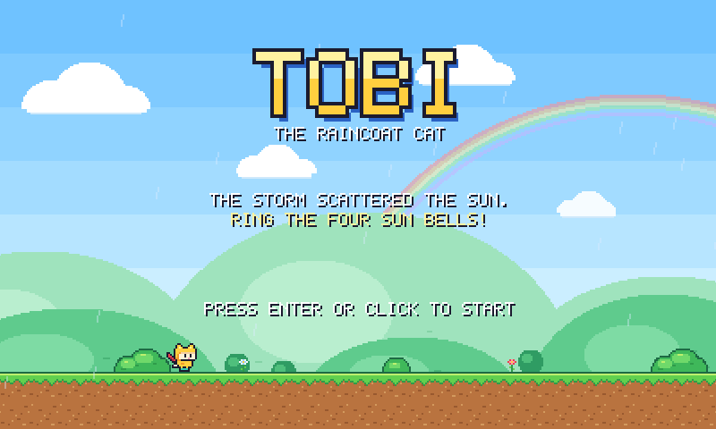
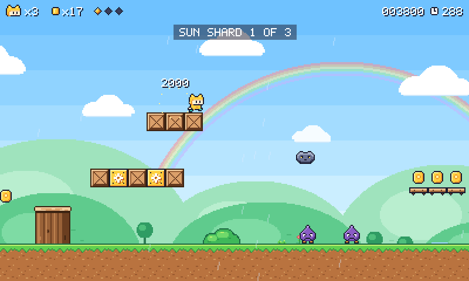
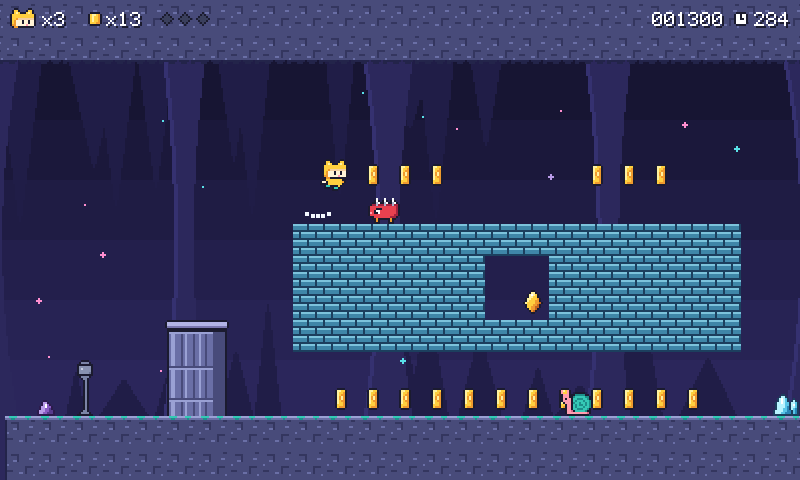
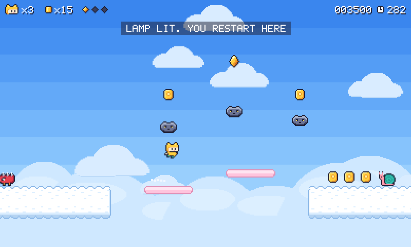
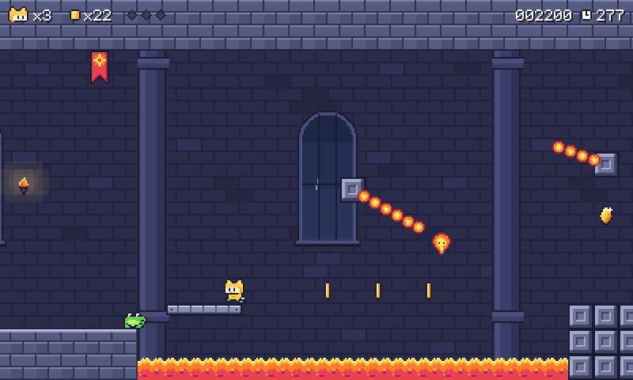

# Tobi the Raincoat Cat

A small side-scrolling platform game in the style of the classic Mario games, with a hero of its own: Tobi, a cat in a yellow raincoat. The storm has scattered the sun. Run, jump and glide through four stages and ring the sun bell at the end of each one.



The whole game is one file, [`index.html`](index.html). It needs no installation and no other files: the pictures are drawn by the code, and the music and sound effects are made by the code as you play.

## Play

1. Open [`index.html`](index.html) here on GitHub and download it (the **Download raw file** button above the code).
2. Open the downloaded file on a computer. It starts in your web browser.

It works with a keyboard or a gamepad, and it needs no internet connection. Opened as a web page on a phone or tablet, it shows touch buttons under the screen instead.

## Controls

| | Keyboard | Gamepad |
|---|---|---|
| Move | <kbd>←</kbd> <kbd>→</kbd> or <kbd>A</kbd> <kbd>D</kbd> | Stick or d-pad |
| Jump (hold longer to jump higher) | <kbd>Space</kbd>, <kbd>Z</kbd>, <kbd>↑</kbd> or <kbd>W</kbd> | A or Y |
| Run (hold it) | <kbd>Shift</kbd> or <kbd>X</kbd> | X, B or a right shoulder button |
| Start and continue | <kbd>Enter</kbd> | A or Start |
| Pause | <kbd>P</kbd> or <kbd>Esc</kbd> | Start |
| Music on or off | <kbd>M</kbd> | |
| Back to the title screen (while paused) | <kbd>Q</kbd> | |

On a touch screen there are two arrows, **B** to run and **A** to jump. Slide your thumb onto both round buttons to run and jump together.

## How the game goes

- Reach the bell at the end of each stage. The higher up its post you touch it, the bigger the bonus.
- You have three tries. When you lose one, you start again from the last lamp you passed. A hundred coins earn one more try.
- Each stage is on a clock. When it runs out you lose a try, so keep moving.
- Three sun shards are hidden in every stage. You can finish without them; the ending tells you how many of the twelve you found.
- Every stage can be finished without the run button.
- The stages you have reached, your best score and your sound settings are remembered in your browser. Once you have reached a later stage, <kbd>←</kbd> and <kbd>→</kbd> on the title screen choose where to begin.

<table>
<tr>
<td width="50%"><br><b>1. Drizzle Meadow</b><br>Stumps, ponds and your first snail.</td>
<td width="50%"><br><b>2. Snail Hollow</b><br>Lifts over a deep pit and a floor of crystal spikes.</td>
</tr>
<tr>
<td><br><b>3. Nimbus Heights</b><br>Springs, falling rafts and a rainbow bridge.</td>
<td><br><b>4. Thunder Keep</b><br>Lava, turning ember chains and stone crushers.</td>
</tr>
</table>

### Who and what you meet

| Name | What to know |
|---|---|
| **Grumble** | A sulky raindrop. Land on it. |
| **Snail** | Land on it, then kick the shell. Mind the rebound. |
| **Prickle** | Spikes on top. Jump over it, or send a shell. |
| **Hopper** | Leaps at you. Stomp it between hops. |
| **Flit** | Drifts in the air. Bounce off it to go higher. |
| **Sun block** | Hit it from below for coins and items. |
| **Umbrella** | Hold jump in the air to glide. It also smashes crates and takes one hit for you. |
| **Sun drop** | For ten seconds nothing can hurt you. |
| **Heart** | One more try. Hearts hide inside crates. |

## How it is made

Plain JavaScript drawing on an HTML canvas, with no libraries and no image or sound files.

- **The rules** run sixty times a second and are kept apart from the drawing, so the checks below can run the same rules without a screen.
- **The art** is written as small grids of letters, one letter per pixel, and turned into pictures when the game starts. Ground, scenery and skies are painted by code in four colour schemes.
- **The sound** is made from simple waves: 27 effects and a tune for every stage.
- **The controls** aim for the feel of the classics: you can still jump a moment after running off a ledge, a jump pressed just before landing still counts, and letting go early makes a shorter hop.

```
index.html        the game: this is the file to play
build.js          joins the parts in src/ into index.html
package.json      the names of the check commands
src/
  00-page.html    the page around the game: styles, buttons and the manual
  05-contents.js  the note at the top of the script
  10-sim.js       the rules: movement, collisions, creatures, items, camera
  20-levels.js    the four stages, written as short building steps
  30-art.js       the hero, creatures and items as grids of letters
  32-tiles.js     ground, blocks, scenery and backdrops
  34-font.js      the 5x7 pixel alphabet
  40-render.js    putting the scene on the screen
  50-audio.js     sound effects and music
  60-game.js      controls, screens, saving and the main loop
test/             the checks described below
screenshots/      the pictures on this page
```

### Changing it

`index.html` is built from the parts in `src/`. Change a part, then join them again (this needs [Node.js](https://nodejs.org), version 18 or newer):

```
node build.js
```

Good places to start:

- `PH` in `src/10-sim.js`: how fast the hero runs and how high it jumps. `node test/metrics.js` measures the result.
- `LEVELS` in `src/20-levels.js`: the layout of every stage. `node test/dump.js 0` prints the first stage as a map.
- `PAL` and the letter grids in `src/30-art.js`: colours and sprites.
- `SONGS` in `src/50-audio.js`: the tunes.

### Checks

```
npm test               # a few seconds: rules, stage layouts, music, button mashing
npm run test:proofs    # 10 to 20 minutes: every stage finished, every shard collected
npm run test:browser   # the whole game in a real browser, plus touch, sound and layout
```

The first two need only Node.js. The browser checks use [Playwright](https://playwright.dev); install it once with `npm install` and `npx playwright install chromium`.

- `test/rules.js` checks the rules one at a time on tiny purpose-built levels: 56 checks, from jump timing to shell kicks.
- `test/levels.js` looks for mistakes in the stages, such as a creature inside a wall or an item block with no room above it.
- `test/songs.js` checks that the parts of each tune line up and that every note is a real one.
- `test/fuzz.js` mashes random buttons through every stage for 360,000 steps and makes sure nothing breaks.
- `test/prove.js` uses a search-based player (`test/bot.js`) to show that every stage can be finished from the start and from every lamp, without the umbrella, without being hit, and also without ever using the run button. It then shows that all twelve sun shards can be collected: ten with nothing but jumps, two with the umbrella.
- `test/e2e.js` has the same player finish all four stages in a real browser, from the title screen to the ending.
